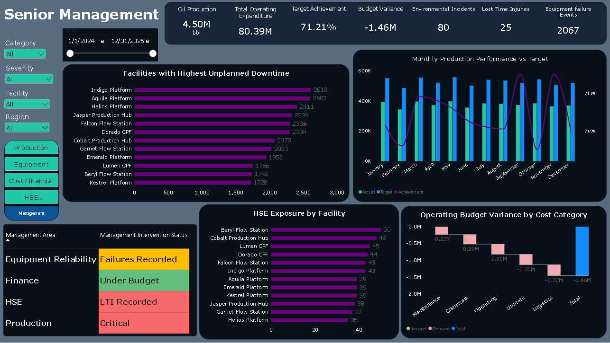
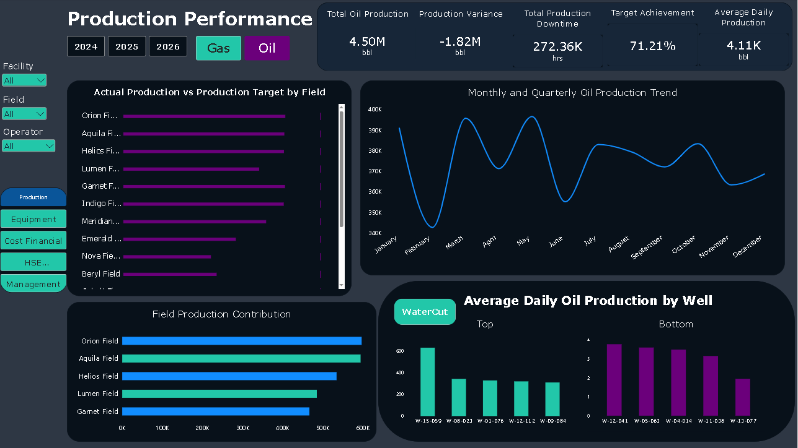
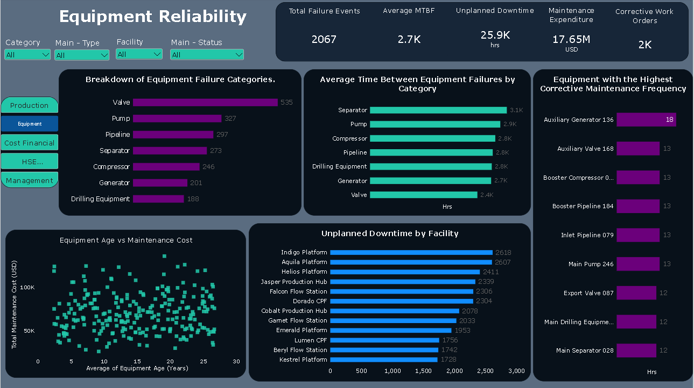
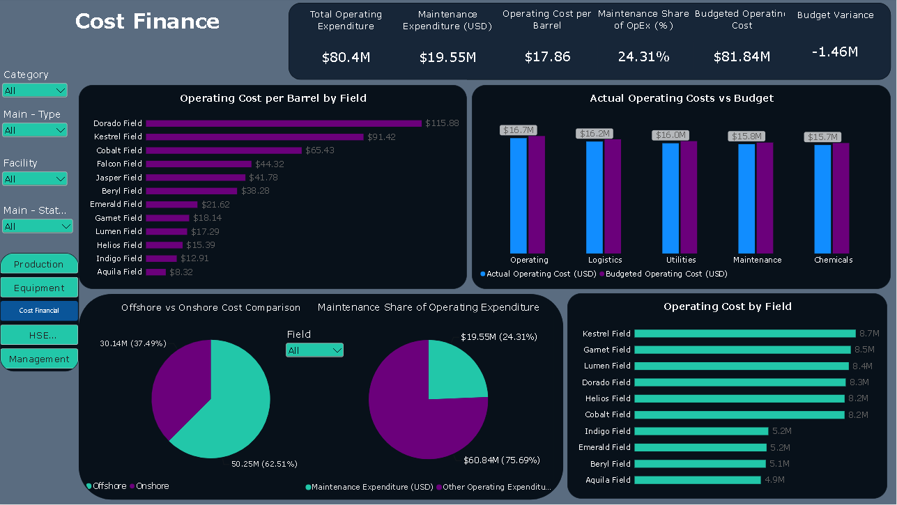
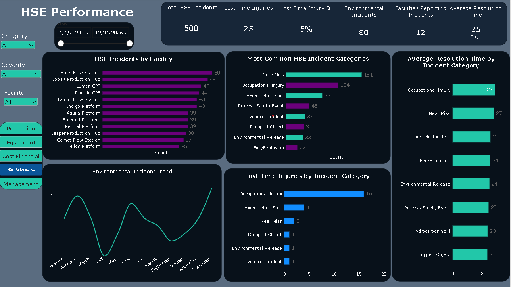

# Oil & Gas Operations Analytics

An end-to-end business intelligence project analysing synthetic oil and gas operational data across production performance, equipment reliability, operating expenditure and HSE.

**Tools:** PostgreSQL · SQL · Python · Pandas · NumPy · SciPy · Statsmodels · Matplotlib · Seaborn · Power BI

> **Data disclosure:** This is an independent portfolio project built with synthetic data. It does not represent the operations, financial performance or safety record of a real oil and gas operator.

## Project at a glance

| Project component | Scope |
|---|---|
| Reporting period | 1 January 2024 – 31 December 2026 |
| Source datasets | 10 relational datasets |
| Validated records | 67,023 |
| Database | PostgreSQL |
| Analytical layer | 6 SQL analytical views |
| Statistical work | Python/Jupyter Notebook |
| Business intelligence | Five-page Power BI dashboard |
| Dashboard canvas | 1920 × 1080 per page |

The solution follows a practical analytics workflow: inspect and validate source data, build a relational database, prepare analytical views, investigate business questions, and communicate the findings through an interactive dashboard and management reporting.

## Business context

Oil and gas operators need reliable information to monitor production, understand operational interruptions, manage asset reliability, control expenditure and identify recurring health, safety and environmental (HSE) concerns.

This project simulates that environment and develops an integrated analytical solution for operational and management stakeholders.

## Business questions investigated

### 1. Production performance
- How does actual production compare with production targets?
- Which fields and wells contribute most to production?
- How do production trends vary over time?
- Where do downtime and production performance warrant further investigation?

### 2. Equipment reliability
- Which equipment categories account for the largest maintenance workload?
- Where are corrective maintenance and unplanned downtime concentrated?
- Which assets or facilities may require maintenance attention?
- What patterns appear in maintenance frequency and expenditure?

### 3. Cost and financial performance
- How does operating expenditure compare with budget?
- Which fields contribute most to operating costs?
- What is the relationship between operating expenditure and production?
- How is expenditure distributed across operating cost categories?

### 4. HSE performance
- Which facilities record the highest incident counts?
- Which incident categories occur most frequently?
- What patterns appear in incident severity and resolution?
- Where should HSE teams investigate recurring risks?

### 5. Management oversight
- What are the key operational performance indicators?
- Which areas show material variances or emerging concerns?
- Where should management prioritise further investigation?

## Technical workflow

1. **Data inspection and profiling** — review the ten source datasets and identify data quality issues.
2. **PostgreSQL database development** — load the datasets into a relational database and establish primary/foreign-key relationships.
3. **Data cleaning and validation** — address missing values, inconsistent categories, invalid values and referential-integrity issues.
4. **SQL analytics** — prepare analytical views and query the operational business questions.
5. **Python statistical analysis** — explore distributions, trends, relationships and potential anomalies in the prepared production dataset.
6. **Power BI reporting** — build an interactive dashboard for operational and management users.
7. **Business interpretation** — communicate findings, limitations and recommended areas for investigation.

## Power BI dashboard

The supplied Power BI report contains five pages, each with a 1920 × 1080 canvas and a total of 101 visual definitions in the report:

| Page in report | Audience / focus |
|---|---|
| Management | Senior management; consolidated performance and areas requiring attention |
| Production | Production trends, targets and operational performance |
| Equipment | Maintenance activity, equipment failures and downtime |
| Cost Financial | Operating expenditure, budgets and cost patterns |
| HSE Performance | Incident frequency, categories and severity |

The report includes a custom Bullet Chart visual. The five dashboard screenshots are published in `powerbi/` and embedded below so visitors can preview the report directly on GitHub.

### Dashboard gallery

#### Senior Management



Consolidates production, expenditure, target achievement, budget variance, environmental incidents, lost-time injuries and equipment failures. It also highlights facilities with high unplanned downtime and areas requiring management attention.

#### Production Performance



Examines oil production against target, monthly trends, field contribution and well-level performance, with facility, field, operator, year and product filters.

#### Equipment Reliability



Explores failure categories, MTBF, corrective maintenance frequency, equipment age and maintenance cost, and unplanned downtime by facility.

#### Cost Finance



Compares operating expenditure with budget, cost per barrel by field, offshore/onshore expenditure and maintenance's share of operating costs.

#### HSE Performance



Reviews incident counts by facility and category, lost-time injuries, environmental incident trends and average resolution time.

> All dashboard figures are generated from synthetic data and are illustrative, not actual operator performance.

## Python statistical analysis

The Jupyter notebook retrieves the production analytical view `analytics.vw_production_daily` from PostgreSQL. Its methods include:

- Descriptive statistics: mean, median, variance, standard deviation, range, skewness and kurtosis.
- IQR-based potential outlier identification.
- Pearson and Spearman correlation coefficients, corresponding significance tests and approximate Fisher z-transformation confidence intervals for Pearson correlation.
- Levene's test and Kruskal–Wallis testing for field-level production comparisons.
- Pairwise Mann–Whitney U tests with Holm multiple-comparison adjustment and rank-biserial effect sizes.
- Daily and monthly production stability using coefficient of variation.
- Linear regression of monthly field production trends using slope, R-squared and p-values.

See [Python statistical methods](documentation/python_statistical_methods.md) for the method descriptions and review notes. Correlation and regression patterns are observational and should not be interpreted as proof of causation.

## PostgreSQL database and SQL workflow

The SQL workflow is organised around three schemas:

- `raw` — source tables initially loaded as text.
- `staging` — prepared data used for standardisation and validation.
- `analytics` — relational analytical tables and reusable views.

The supplied SQL scripts cover raw and staging table creation, duplicate checks, missing-value and whitespace audits, standardisation, data validation, orphan foreign-key checks, analytics table creation, analytical views and business-question analysis.

See [PostgreSQL workflow](documentation/postgresql_workflow.md) for the architecture and script inventory.

## Repository guide

```text
Oil_Gas_analytics/
├── README.md
├── documentation/
│   ├── project_methodology.md
│   ├── data_limitations.md
│   ├── python_statistical_methods.md
│   └── postgresql_workflow.md
├── sql/                 # SQL scripts to be published
├── python/              # Jupyter notebook to be published
├── powerbi/
│   ├── dashboard_documentation.md
│   ├── Production_Performance.png
│   ├── Equipment_Reliability.png
│   ├── Cost_Finance.png
│   ├── HSE_Performance.png
│   └── Senior_Management.png
└── ...
```

The documentation files are published. The SQL workflow scripts, dashboard documentation and five dashboard screenshot assets are published. The Python notebook and PBIX report should be added as downloadable project files when ready; the screenshots provide a visual preview in the meantime.

## Data limitations and analytical integrity

- The source data is synthetic and intended for learning and portfolio demonstration.
- The database contains 67,023 records across ten datasets after the project's loading and validation workflow.
- The production notebook analyses the prepared daily production view, not every source dataset.
- Statistical association should not be interpreted as proof of causation.
- Some operational KPIs require denominators or source fields that may not be available. Unsupported measures should be identified rather than estimated.
- A reliable TRIR or LTIFR requires workforce-hours, which are not available in the described source data. Incident counts should not be presented as exposure-adjusted safety rates.
- Potential outliers are investigation flags, not automatically erroneous observations.

See [Data limitations](documentation/data_limitations.md) for further detail.

## Reproducibility

The SQL scripts, notebook and supporting documentation are intended to make the workflow understandable and reproducible. The Power BI report requires a compatible Power BI Desktop installation. Where source data cannot be redistributed, publish schema and data-dictionary documentation rather than imply that the original datasets are included.

## Author

**Mahabubulah Adebiyi**  
Data Analyst | Business Intelligence Analyst

- GitHub: [@DanFalak7](https://github.com/DanFalak7)
- Portfolio: [GitHub repositories](https://github.com/DanFalak7?tab=repositories)

---

*This project demonstrates an end-to-end analytical workflow, from relational data preparation to statistical investigation and business intelligence reporting.*
