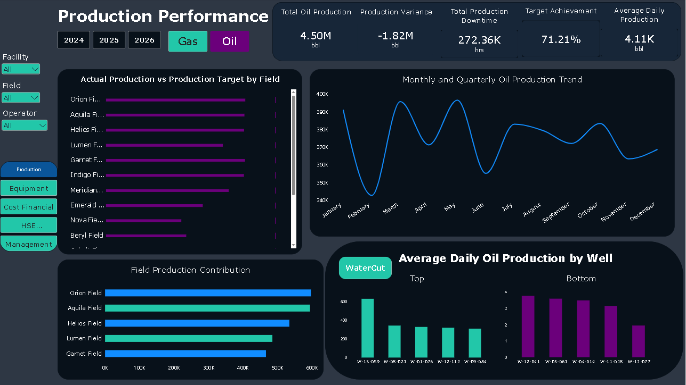
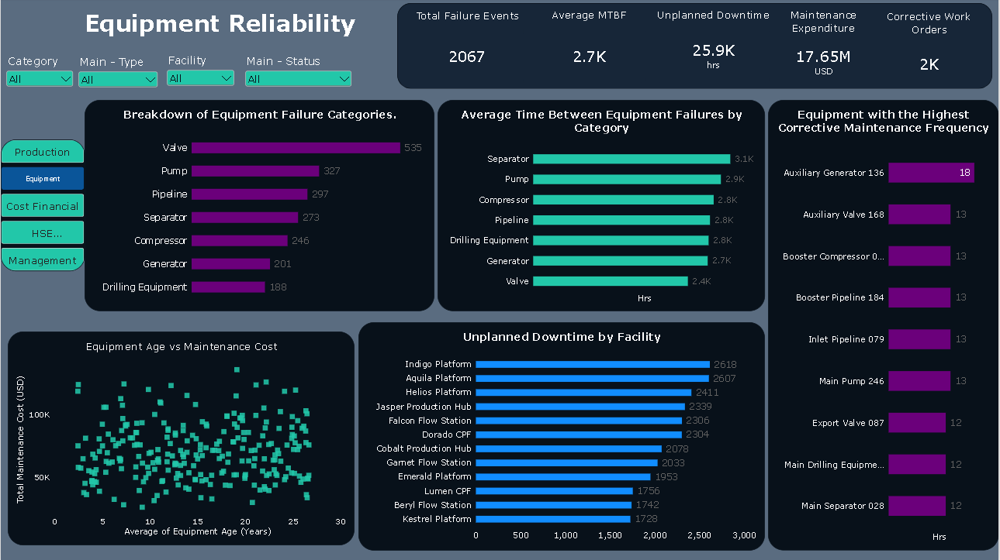
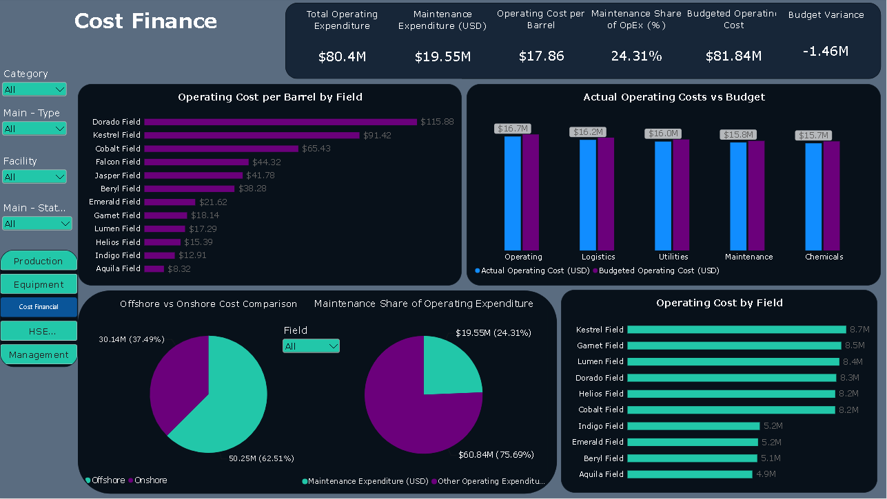
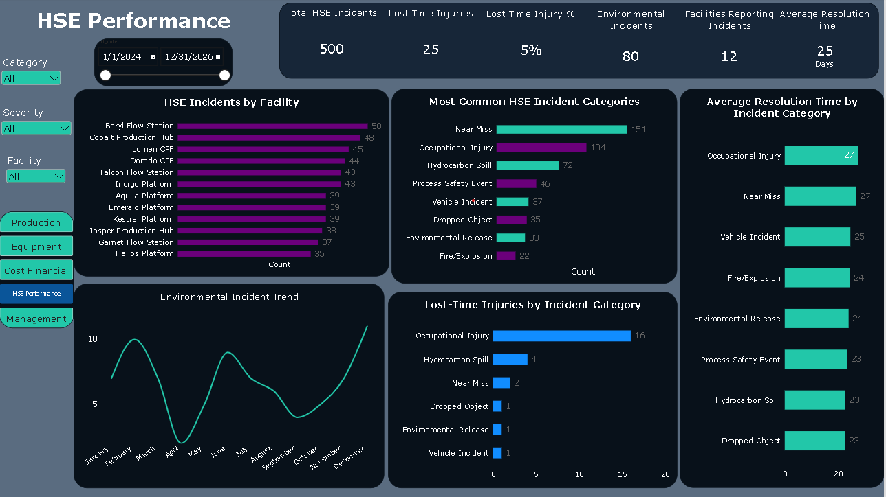
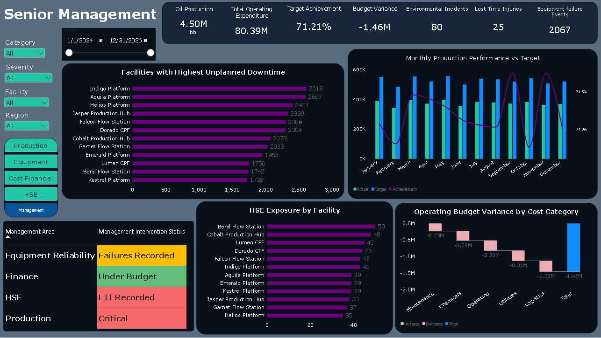

# Power BI Dashboard Documentation

## Overview

This Power BI report presents an operational performance dashboard for a synthetic oil and gas business. It brings together production, equipment reliability, operating costs and HSE indicators for management review.

The report uses the PostgreSQL `analytics` layer. The dataset is synthetic and does not represent actual operational, safety, production or financial information from an oil and gas operator.

## Report structure

The report contains five pages, each captured at approximately 16:9 widescreen resolution.

| Page | Visual count* | Main purpose |
|---|---:|---|
| Production Performance | 22 | Production volumes, targets, field contribution and well performance |
| Equipment Reliability | 18 | Equipment failures, MTBF, corrective maintenance and downtime |
| Cost Finance | 22 | Operating expenditure, cost per barrel, budget comparison and cost composition |
| HSE Performance | 19 | Incident categories, injuries, environmental incidents and resolution time |
| Senior Management | 20 | Cross-functional KPIs, monthly production performance, downtime, HSE exposure and budget variance |

*Visual counts reflect the report inventory previously inspected in the Power BI file. Total: 101 visuals.

## Page-by-page walkthrough

### 1. Production Performance

The page provides year, product (gas/oil), facility, field and operator filters. Its KPI strip includes total oil production, production variance, total production downtime, target achievement and average daily production.

Visuals include:
- Actual production versus production target by field.
- Monthly and quarterly oil production trend.
- Field production contribution.
- Average daily oil production by well, including top and bottom performers.
- A WaterCut selector/measure.

The screenshot shows a total oil production KPI of approximately 4.50 million barrels, production variance of approximately -1.82 million barrels, production downtime of approximately 272.36K hours, target achievement of 71.21%, and average daily production of approximately 4.11K barrels. These are outputs from the synthetic dataset and report measures.

### 2. Equipment Reliability

The page supports filtering by equipment category, main equipment type, facility and maintenance status. Its KPI strip shows total failure events, average MTBF, unplanned downtime, maintenance expenditure and corrective work orders.

Visuals include:
- Breakdown of equipment failure categories.
- Average time between equipment failures by category.
- Equipment with the highest corrective maintenance frequency.
- Equipment age versus maintenance cost.
- Unplanned downtime by facility.

The displayed KPI values include 2,067 failure events, average MTBF of approximately 2.7K hours, unplanned downtime of approximately 25.9K hours, maintenance expenditure of approximately USD 17.65M and approximately 2K corrective work orders.

### 3. Cost Finance

The page provides category, equipment-type, facility and maintenance-status filters. Its KPI strip includes total operating expenditure, maintenance expenditure, operating cost per barrel, maintenance share of OpEx, budgeted operating cost and budget variance.

Visuals include:
- Operating cost per barrel by field.
- Actual operating costs versus budget.
- Offshore versus onshore cost comparison.
- Maintenance share of operating expenditure.
- Operating cost by field.

The screenshot shows total operating expenditure of approximately USD 80.4M, maintenance expenditure of approximately USD 19.55M, operating cost per barrel of USD 17.86, maintenance share of 24.31%, budgeted operating cost of approximately USD 81.84M and a favourable budget variance of approximately -USD 1.46M (subject to the report's variance sign convention).

### 4. HSE Performance

The page provides category, severity, facility and date-range filters. Its KPI strip includes total HSE incidents, lost-time injuries, lost-time injury percentage, environmental incidents, facilities reporting incidents and average resolution time.

Visuals include:
- HSE incidents by facility.
- Most common HSE incident categories.
- Average resolution time by incident category.
- Environmental incident trend.
- Lost-time injuries by incident category.

The screenshot shows 500 HSE incidents, 25 lost-time injuries, a 5% lost-time injury percentage, 80 environmental incidents, 12 facilities reporting incidents and an average resolution time of 25 days.

### 5. Senior Management

The management page consolidates operational indicators across the report. It includes filters for category, severity, facility and region, plus a date range.

Visuals include:
- KPI summary covering production, operating expenditure, target achievement, budget variance, environmental incidents, lost-time injuries and equipment failure events.
- Facilities with highest unplanned downtime.
- Monthly production performance versus target.
- HSE exposure by facility.
- Operating budget variance by cost category.
- Management intervention status by area.

The management view is intended to help identify areas requiring attention and direct users to the relevant detailed report page.

## Data and model architecture

The report is built on the PostgreSQL `analytics` schema. The repository documents the pipeline:

1. Raw source tables.
2. Typed staging tables.
3. Missing-value treatment, standardisation and validation.
4. Referential-integrity checks and corrections.
5. Analytics tables with relational constraints.
6. Analytical views.
7. Power BI model and report pages.

The report includes a custom Bullet Chart visual.

## Items to correct or verify before final portfolio publication

The supplied screenshots reveal two presentation/data-model checks worth resolving:

1. **HSE page title:** The HSE screenshot's page heading reads “Equipment Reliability”, although the navigation indicates the HSE page is selected. Rename the heading to “HSE Performance” so the page is not confused with the equipment page.
2. **Management production KPI:** The management screenshot labels a value of 272.36K as “Oil Production”. The Production page shows 272.36K hours for “Total Production Downtime”, while total oil production is approximately 4.50M barrels. Verify the measure assigned to the management KPI card and correct its label or measure before publishing the final report.

These are visual consistency checks based on the supplied screenshots; they should be verified in Power BI Desktop before changing the report.

## Reproducing the report

1. Set up the PostgreSQL database using the SQL scripts in this repository.
2. Load and validate the staging and analytics tables.
3. Create the analytical views.
4. Open the Power BI report in Power BI Desktop.
5. Configure the PostgreSQL connection for the local environment and refresh the model.

Do not commit database passwords, credentials or machine-specific connection settings.

## Interpretation and limitations

- The project uses synthetic data; the figures are demonstrations of analytical workflow and dashboard design, not evidence about a real operator.
- Dashboard findings depend on the synthetic dataset, business rules, filters and DAX measures.
- Do not infer rates requiring workforce-hours exposure data (such as TRIR or LTIFR) without the required denominator.
- Interpret budget variance using the measure's documented sign convention.

## Dashboard screenshot gallery

The following screenshots are committed in this repository and can be viewed directly on GitHub.

### Production Performance

### Equipment Reliability

### Cost Finance

### HSE Performance

### Senior Management

All figures shown are synthetic and intended for portfolio demonstration only.
